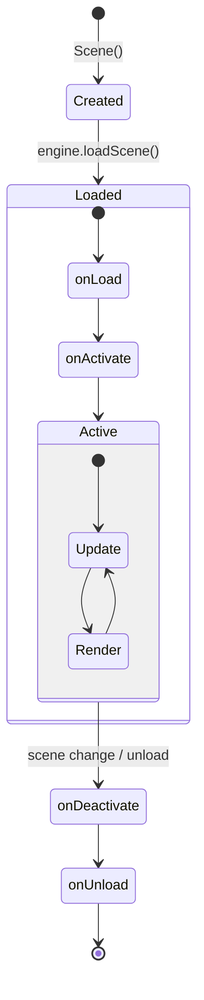

# Scenes

Scenes contain your game world and manage GameObjects.

## Scene Types

```
┌─────────────────────────────────────────────────────────────────────┐
│                         Scene (Protocol)                             │
│  ┌───────────────────────────────────────────────────────────────┐  │
│  │  onLoad(engine:)                                               │  │
│  │  onUnload(engine:)                                             │  │
│  │  onActivate(engine:)                                           │  │
│  │  onDeactivate(engine:)                                         │  │
│  │  update(context:input:)                                        │  │
│  │  render(context:)                                              │  │
│  └───────────────────────────────────────────────────────────────┘  │
│                              ▲                                       │
│                              │ implements                            │
│  ┌───────────────────────────┴───────────────────────────────────┐  │
│  │                     GameObjectScene                            │  │
│  │  ┌─────────────────────────────────────────────────────────┐  │  │
│  │  │  + createGameObject(name:at:parent:)                    │  │  │
│  │  │  + destroyGameObject(_:)                                │  │  │
│  │  │  + findGameObject(named:)                               │  │  │
│  │  │  + findComponentOfType(_:)                              │  │  │
│  │  │  + findComponentsOfType(_:)                             │  │  │
│  │  └─────────────────────────────────────────────────────────┘  │  │
│  └───────────────────────────────────────────────────────────────┘  │
└─────────────────────────────────────────────────────────────────────┘
```

## Creating a Scene

### Basic Scene (Protocol)

For simple scenes without GameObjects:

```swift
import GameEngine

@MainActor
public final class SplashScreen: Scene {
    private var timer: Float = 0
    
    public init() {}
    
    public func onLoad(engine: Engine) {
        // Load resources
    }
    
    public func onUnload(engine: Engine) {
        // Cleanup
    }
    
    public func onActivate(engine: Engine) {
        timer = 0
    }
    
    public func onDeactivate(engine: Engine) { }
    
    public func update(context: FrameContext, input: Input) {
        timer += Float(context.deltaTime)
        if timer > 3.0 {
            // Transition to game scene
        }
    }
    
    public func render(context: RenderContext) {
        context.renderer.clear(.black)
        // Draw splash image
    }
}
```

### GameObjectScene (Recommended)

For scenes with GameObjects and components:

```swift
import GameEngine

@MainActor
public final class GameLevel: GameObjectScene {
    
    public override func onLoad(engine: Engine) {
        super.onLoad(engine: engine)  // Important!
        
        // Create your game world
        setupLighting()
        setupPlayer()
        setupLevel()
    }
    
    private func setupLighting() {
        let light = createGameObject(name: "Light")
        let sun = light.addComponent(DirectionalLight.self)
        sun.direction = Vec3d(0.5, 1, 0.3)
        
        let ambient = light.addComponent(AmbientLight.self)
        ambient.intensity = 0.2
    }
    
    private func setupPlayer() {
        let player = createGameObject(name: "Player", at: Vec3d(0, 0, 5))
        player.addComponent(Camera.self)
        player.addComponent(PlayerController.self)
    }
    
    private func setupLevel() {
        // Create floor
        let floor = createGameObject(name: "Floor")
        let renderer = floor.addComponent(MeshRenderer.self)
        renderer.mesh = PlaneMesh(width: 20, depth: 20)
        renderer.material = Material.matte(.gray)
    }
    
    public override func update(context: FrameContext, input: Input) {
        // Handle input before component updates
        if let controller = findComponentOfType(PlayerController.self) {
            controller.setInput(input)
        }
        
        super.update(context: context, input: input)  // Updates all components
    }
    
    public override func render(context: RenderContext) {
        // Clear and render
        let bgColor = Camera.main?.backgroundColor ?? .black
        context.renderer.clear(bgColor)
        
        guard let camera = Camera.main else { return }
        
        let meshRenderers = findComponentsOfType(MeshRenderer.self)
        RenderPipeline.shared.render(
            meshRenderers: meshRenderers,
            camera: camera,
            context: context
        )
    }
}
```

## Scene Lifecycle



### Lifecycle Methods

| Method | When Called | Use For |
|--------|-------------|---------|
| `onLoad()` | Scene is loaded | Create GameObjects, load assets |
| `onActivate()` | Scene becomes active | Start music, reset state |
| `update()` | Every frame | Game logic |
| `render()` | Every frame | Drawing |
| `onDeactivate()` | Another scene loaded | Pause, save state |
| `onUnload()` | Scene is unloaded | Cleanup |

## Loading Scenes

```swift
// In your entry point
let engine = Engine(config: config)
engine.loadScene(MainMenuScene())
engine.run()

// Switch scenes at runtime (e.g., from a component)
// Note: You need a reference to the engine
public final class LevelComplete: Component {
    weak var engine: Engine?
    
    func goToNextLevel() {
        engine?.loadScene(Level2Scene())
    }
}
```

## Scene Querying

### Finding GameObjects

```swift
// Find by name (first match)
let player = findGameObject(named: "Player")

// Find all with name
let enemies = findGameObjects(named: "Enemy")

// Find by tag
let collectibles = findGameObjectsWithTag("collectible")
```

### Finding Components

```swift
// Find single component
let camera = findComponentOfType(Camera.self)

// Find all components
let allRenderers = findComponentsOfType(MeshRenderer.self)
let allLights = findComponentsOfType(DirectionalLight.self)
```

## GameObjectScene Properties

```swift
// Access all root GameObjects
let roots = rootGameObjects

// Access all GameObjects (including children)
let all = allGameObjects

// Reference to engine
let engine = self.engine

// Fixed timestep for physics
fixedDeltaTime = 1.0 / 50.0  // 50Hz physics
```

## Scene Patterns

### Scene with Multiple Cameras

```swift
public override func render(context: RenderContext) {
    let allRenderers = findComponentsOfType(MeshRenderer.self)
    
    // Main view (full screen)
    if let mainCamera = Camera.main {
        context.renderer.clear(mainCamera.backgroundColor)
        RenderPipeline.shared.render(
            meshRenderers: allRenderers,
            camera: mainCamera,
            context: context
        )
    }
    
    // Minimap camera (corner)
    if let minimapCam = findGameObject(named: "MinimapCamera")?
        .getComponent(Camera.self) {
        // Render to a viewport region
        // (Would need viewport support in renderer)
    }
}
```

### Scene with Pause State

```swift
@MainActor
public final class GameLevel: GameObjectScene {
    private var isPaused = false
    
    public override func update(context: FrameContext, input: Input) {
        // Toggle pause
        if input.isKeyPressed(.escape) {
            isPaused.toggle()
        }
        
        // Skip component updates when paused
        if !isPaused {
            super.update(context: context, input: input)
        }
    }
    
    public override func render(context: RenderContext) {
        // Always render scene
        renderScene(context: context)
        
        // Overlay pause menu
        if isPaused {
            renderPauseMenu(context: context)
        }
    }
}
```

### Scene with Loading Screen

```swift
@MainActor
public final class LoadingScene: Scene {
    private var nextScene: Scene
    private var isLoaded = false
    
    public init(nextScene: Scene) {
        self.nextScene = nextScene
    }
    
    public func update(context: FrameContext, input: Input) {
        if !isLoaded {
            // In a real engine, this would be async
            loadAssets()
            isLoaded = true
        } else {
            // Transition to next scene
            // (Would need engine reference)
        }
    }
    
    public func render(context: RenderContext) {
        context.renderer.clear(.black)
        // Draw loading bar
    }
    
    private func loadAssets() {
        // Load textures, meshes, etc.
    }
}
```

## Best Practices

1. **Call super methods** - Always call `super.onLoad()`, `super.update()` in GameObjectScene
2. **Create GameObjects in onLoad** - Not in init
3. **Use onActivate for resets** - Scene may be reused
4. **Query once, cache results** - Don't search every frame
5. **Keep scenes focused** - One scene = one game state
