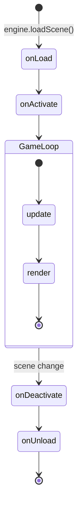

# Getting Started

This guide will walk you through setting up your first GameEngine project.

## Prerequisites

Before you begin, ensure you have:

- **Swift 6.0+** installed
- **Visual Studio 2022** Build Tools
- **Windows 10/11**

## Project Structure

```
YourProject/
├── Package.swift
├── build.ps1
├── Sources/
│   ├── GameEngine/          ← Engine library (don't modify)
│   └── Game/                ← Your game code
│       ├── App.swift        ← Entry point
│       └── Scenes/          ← Your scenes
└── Tests/
    └── GameEngineTests/
```

## Creating Your First Scene

### Step 1: Set Up the Entry Point

Create `Sources/Game/App.swift`:

```swift
import GameEngine

@main
@MainActor
struct MyGame {
    static func main() {
        // Configure the engine
        let config = EngineConfig(
            title: "My First Game",
            width: 800,
            height: 600,
            targetFps: 60,           // Optional: cap framerate
            showFpsInTitle: true     // Show FPS in window title
        )
        
        // Create and run the engine
        let engine = Engine(config: config)
        engine.loadScene(HelloWorldScene())
        engine.run()
    }
}
```

### Step 2: Create Your Scene

Create `Sources/Game/Scenes/HelloWorldScene.swift`:

```swift
import GameEngine

@MainActor
public final class HelloWorldScene: GameObjectScene {
    
    public override func onLoad(engine: Engine) {
        super.onLoad(engine: engine)
        
        // ─────────────────────────────────────────────
        // 1. Set up lighting
        // ─────────────────────────────────────────────
        let lightObject = createGameObject(name: "Light")
        
        let sun = lightObject.addComponent(DirectionalLight.self)
        sun.direction = Vec3d(0.5, 1.0, 0.3)  // Points toward light
        sun.intensity = 1.0
        
        let ambient = lightObject.addComponent(AmbientLight.self)
        ambient.intensity = 0.2
        
        // ─────────────────────────────────────────────
        // 2. Create a camera
        // ─────────────────────────────────────────────
        let cameraObject = createGameObject(name: "Camera", at: Vec3d(0, 2, 5))
        let camera = cameraObject.addComponent(Camera.self)
        camera.projection = .perspective
        camera.fieldOfView = 60.0
        camera.backgroundColor = Color(r: 30, g: 30, b: 40)
        
        // Optional: Add player controls
        let controller = cameraObject.addComponent(PlayerController.self)
        controller.moveSpeed = 5.0
        
        // ─────────────────────────────────────────────
        // 3. Create a cube
        // ─────────────────────────────────────────────
        let cube = createGameObject(name: "Cube", at: Vec3d(0, 0, 0))
        
        let material = Material.solid(.cornflowerBlue)
        material.shadingModel = .flat
        
        let renderer = cube.addComponent(MeshRenderer.self)
        renderer.mesh = CubeMesh.shared
        renderer.material = material
        
        // Make it spin!
        let rotator = cube.addComponent(Rotator.self)
        rotator.axis = .up
        rotator.speed = 1.0
    }
    
    private var playerController: PlayerController?
    
    public override func update(context: FrameContext, input: Input) {
        // Find player controller on first update
        if playerController == nil {
            playerController = findComponentOfType(PlayerController.self)
        }
        playerController?.setInput(input)
        
        super.update(context: context, input: input)
    }
    
    public override func render(context: RenderContext) {
        // Clear screen
        let bgColor = Camera.main?.backgroundColor ?? .black
        context.renderer.clear(bgColor)
        
        guard let camera = Camera.main else { return }
        
        // Render all meshes
        let meshRenderers = findComponentsOfType(MeshRenderer.self)
        RenderPipeline.shared.render(
            meshRenderers: meshRenderers,
            camera: camera,
            context: context
        )
    }
}
```

### Step 3: Build and Run

```powershell
# Build in release mode (faster)
.\build.ps1 build-release

# Run the game
.\build.ps1 run-release
```

## Controls

Default controls when using `PlayerController`:

| Key / Action | Description |
|--------------|-------------|
| `W` / `↑` | Move forward |
| `S` / `↓` | Move backward |
| `A` / `←` | Strafe left |
| `D` / `→` | Strafe right |
| `E` | Move up |
| `Q` | Move down |
| `Left Click` | Capture mouse (enable FPS-style look) |
| `Right Click` | Release mouse capture |
| `ESC` | Exit the game |

### Mouse Capture

For FPS-style camera controls, the mouse can be captured to enable free look:

```swift
// Capture programmatically
engine.captureMouse()

// Release
engine.releaseMouse()

// Toggle
engine.toggleMouseCapture()

// Check state
if engine.isMouseCaptured { ... }
```

When captured, the cursor is hidden and locked to the window center. The `PlayerController` component will automatically use mouse movement for camera rotation when `enableMouseLook` is set to `true` and the mouse is captured.

## Scene Lifecycle



## What's Next?

- [Architecture Overview](architecture/overview.md) - Understand how the engine works
- [GameObjects & Components](core/gameobject-component.md) - Entity-component system
- [Materials](graphics/materials.md) - Customize appearance
- [Creating Custom Components](examples/custom-components.md) - Extend the engine
